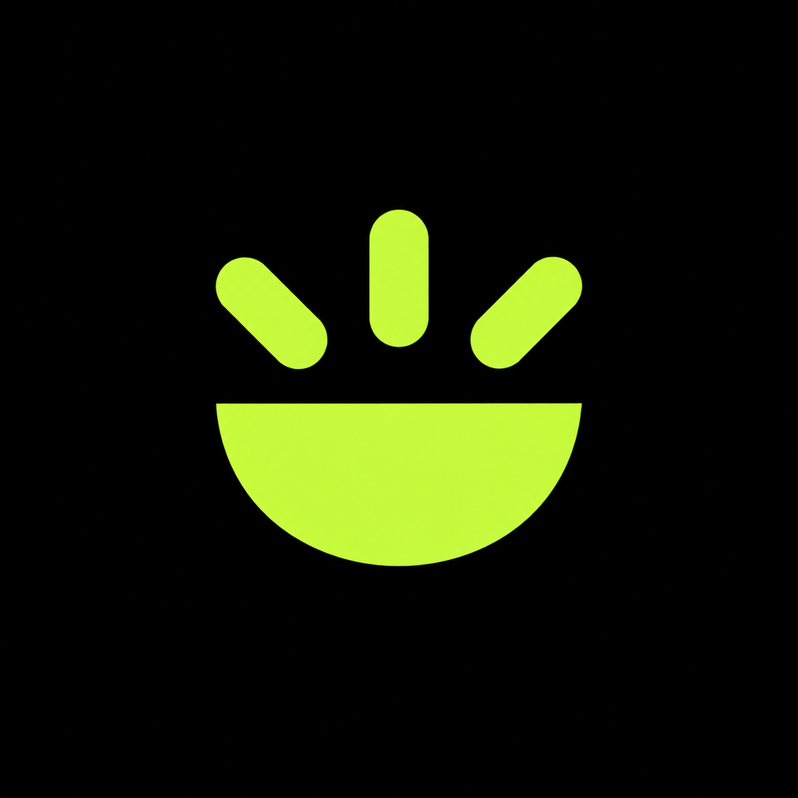
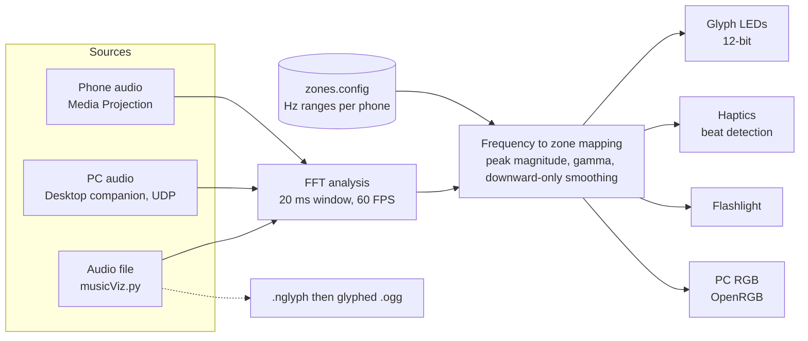

<div align="center">


<br/><br/>



<br/><br/>

<a href="https://github.com/oliver-lebaigue-bright-bench/glyph-syncronator/releases"></a>
<a href="https://discord.gg/cQ4hxNE8fX"></a>
<a href="LICENSE"></a>

<br/><br/>

[](https://github.com/colmlenehan-gh/Glyphicks/actions/workflows/ci.yml)
[](https://github.com/oliver-lebaigue-bright-bench/glyph-syncronator/releases)
[](https://github.com/oliver-lebaigue-bright-bench/glyph-syncronator/stargazers)
[](https://github.com/oliver-lebaigue-bright-bench/glyph-syncronator/issues)
[](#supported-devices)

**[What it is](#what-it-is)** · **[Quick start](#quick-start)** · **[How it works](#how-it-works)** · **[Desktop companion](#desktop-companion)** · **[Build from source](#build-from-source)** · **[Repository map](#repository-map)** · **[Contributing](#contributing)**

</div>

---

## What it is

**Glyphix** delivers real-time music visualization for Nothing Phone Glyphs, haptics and the flashlight. It runs **FFT audio analysis** on whatever is playing and maps frequency bands to individual Glyph zones at **60 FPS** with **12-bit brightness**.

| | Stock visualizer | **Glyphix** |
| :--- | :--- | :--- |
| **Light depth** | about 3 levels | **4,096 levels (12-bit)** |
| **Frame rate** | 20 FPS | **60 FPS** |
| **Precision** | Low, unreliable | **FFT-based, deterministic** |
| **Control** | Whole glyph strips | **Independent zone mapping** |

Glyphix is a small family of tools that share one analysis idea:

| Component | What it does | Where |
| :--- | :--- | :--- |
| **Android app** | Captures device audio, analyses it live, drives Glyphs, haptics and flashlight | [`app/`](app) |
| **Desktop companion** | Streams your PC's audio to the phone over UDP and syncs PC RGB through OpenRGB | [`desktop-companion/`](desktop-companion), [`desktop-companion-wpf/`](desktop-companion-wpf) |
| **Offline script** | Turns an audio file into a glyphed `.ogg` for Glyph Composer and similar players | [`PYTHON SCRIPT/`](PYTHON%20SCRIPT) |
| **Website** | The landing page, download page and support centre | [`website/`](website) |
| **Zone config** | Frequency ranges per phone model, shared by the app and the script | [`zones.config`](zones.config), [guide](Docs/ZONES_CONFIG.md) |

## Quick start

1. **Download and install.** Grab the [latest APK](https://github.com/oliver-lebaigue-bright-bench/glyph-syncronator/releases).
2. **Choose an audio source.** Media Projection is recommended.
3. **Press Start** and play music from any app.

> **Bluetooth latency?** Open the **Audio** tab and calibrate the sync offset. Frequency presets can be tuned in `zones.config`, see the [configuration guide](Docs/ZONES_CONFIG.md).

> **Nothing Phone (1)?** Enable the Glyph debug interface first:
> `adb shell settings put global nt_glyph_interface_debug_enable 1`

### Supported devices

| Mode | Devices |
| :--- | :--- |
| **Full Glyph mapping** | Nothing Phone (1), (2), (2a), (2a) Plus, (3), (3a), (3a) Pro, (4a), (4b), (4a) Pro |
| **Haptics and flashlight** | Any Android phone. Everything except per-zone lighting works. |

## How it works



* **FFT**: audio is split into frequency bins every frame, using a 20 ms window per 16.7 ms frame.
* **Zone mapping**: each Glyph zone owns a frequency range from `zones.config`. Its brightness follows the peak magnitude found in that range.
* **Smoothing**: downward-only decay keeps animations snappy without jitter.
* **Haptics and flashlight**: bass amplitude drives continuous glow, and derivative beat detection drives sharp pulses.

## Desktop companion

Stream your computer's audio to the phone so Glyphs, haptics and visualizers react to it, and light your PC RGB gear through [OpenRGB](https://openrgb.org/) at the same time.

| Variant | Platform | Start it |
| :--- | :--- | :--- |
| Python (CustomTkinter GUI) | Windows | `python desktop_companion.py` |
| Python (KivyMD Material UI) | Windows | `python desktop_companion.py --material` |
| Python (macOS) | macOS | `python desktop_companion_macos.py` |
| Native WPF | Windows, .NET 8 | open [`desktop-companion-wpf`](desktop-companion-wpf) in Visual Studio or run `dotnet run` |

On the phone, open the **Audio** tab and select **Desktop Companion (UDP)**. Both devices must be on the same network. Discovery uses UDP port `12348` and audio streams on UDP port `12347`, so allow both through your firewall. Full instructions are in the [companion README](desktop-companion/README.md).

## Offline processing

```bash
pip install -r "PYTHON SCRIPT/requirements.txt"
python "PYTHON SCRIPT/musicViz.py"                       # no arguments: lists the presets from zones.config
python "PYTHON SCRIPT/musicViz.py" <audio_file> <preset> # convert a file
```

`musicViz.py` converts audio into a `.nglyph` file and then uses [SebiAi's GlyphModder](https://github.com/SebiAi/custom-nothing-glyph-tools/) to produce a glyphed OGG. Useful flags: `--nglyph` writes only the `.nglyph` file, `--csv` writes per-zone brightness as CSV, and `--update` re-downloads GlyphModder. On first run the script downloads `zones.config` and GlyphModder from GitHub. Details are in the [script README](PYTHON%20SCRIPT/README.md), and bulk conversion is supported. FFmpeg must be installed.

## Build from source

| Part | Requirements | Commands |
| :--- | :--- | :--- |
| **Android app** | JDK 17, Android SDK (compile 36, min 34) | `./gradlew assembleDebug` to build, `./gradlew installDebug` to install on a connected device |
| **Website** | Node 22, pnpm | `cd website && pnpm install && pnpm run dev` |
| **Website production build** | as above | `pnpm run check && pnpm run build`, output in `website/dist/public` |
| **Python scripts** | Python 3.8+ | `pip install -r requirements.txt` in the relevant folder |

CI runs the website type-check and build, byte-compiles and lints the Python scripts, and validates `zones.config` on every pull request. The website deploys to GitHub Pages from `main`. A debug APK is built by GitHub Actions when a commit message ends with `workflow build`.

## Repository map

```text
app/                    Android app (Kotlin, Java, Jetpack Compose)
androidApp/, shared/,
composeApp/             Kotlin Multiplatform modules
desktop-companion/      Python desktop companions (Windows, macOS, KivyMD)
desktop-companion-wpf/  Native Windows companion (.NET 8, NAudio, OpenRGB.NET)
PYTHON SCRIPT/          Offline audio to glyphed OGG pipeline
website/                Vite + React landing site
zones.config            Frequency zones per phone model
Docs/                   Guides and banners
.github/                Workflows, issue and PR templates, Dependabot
```

## Roadmap

| Idea | Status |
| :--- | :--- |
| Native macOS companion for Apple Silicon with OpenRGB sync | In active development |
| Custom visualizer editor (node-based frames, curves, zone mappings) | Prototyping |
| Community preset cloud (browse, rate, download lighting profiles) | Planned |
| Smart home integrations driven by the FFT engine | Research |

## Contributing

Bug reports, presets for new phone models and pull requests are welcome. Start with [CONTRIBUTING.md](CONTRIBUTING.md), and please read the [security policy](SECURITY.md) before reporting a vulnerability. Chat with the community on [Discord](https://discord.gg/cQ4hxNE8fX) or open an [issue](https://github.com/oliver-lebaigue-bright-bench/glyph-syncronator/issues).

## Privacy

* **Screen capture** is used only through Android Media Projection to read the system audio stream. No video frames or screen content are stored or transmitted.
* **Audio** is processed in real-time memory buffers and is never recorded, saved or uploaded.
* **Analytics** are optional, anonymous usage statistics used to fix crashes.
* **Safety scan**: [VirusTotal report](https://www.virustotal.com/gui/url/c92c1ff82b56eb60bfd1e159592d09f949f0ea2d195e01f7f5adbef0e0b0385b)

## Credits and licence

Glyphix was created by its upstream authors at [oliver-lebaigue-bright-bench/glyph-syncronator](https://github.com/oliver-lebaigue-bright-bench/glyph-syncronator) and the Glyphix community. Offline glyph file conversion relies on [SebiAi's custom-nothing-glyph-tools](https://github.com/SebiAi/custom-nothing-glyph-tools/). Released under the [MIT licence](LICENSE).
