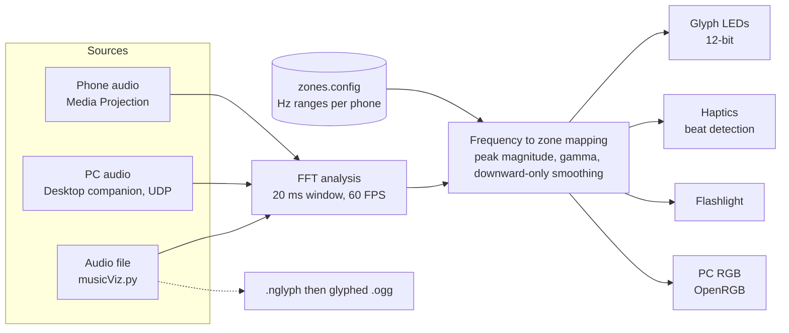

<div align="center">

<!-- Header Banner & Typing Intro -->


<br/>

<h1 align="center"><strong>Fork of Original Project by Oliver Lebaigue</strong></h1>

<br/><br/>


<br/><br/>

<!-- Action Badges -->
<a href="https://github.com/colmlenehan-gh/Glyphicks/releases"></a>
<a href="#-credits--original-project"></a>
<a href="LICENSE"></a>

<br/><br/>

<!-- Live Dynamic Stats Badges -->
[](https://github.com/colmlenehan-gh/Glyphicks/actions/workflows/ci.yml)
[](https://github.com/colmlenehan-gh/Glyphicks/releases)
[](https://github.com/colmlenehan-gh/Glyphicks/stargazers)
[](https://github.com/colmlenehan-gh/Glyphicks/network/members)
[](https://github.com/colmlenehan-gh/Glyphicks/issues)
[](#-supported-devices)

**[About](#-what-is-glyphicks)** · **[Quick start](#-quick-start-guide)** · **[How it works](#-how-it-works)** · **[Desktop companion](#-desktop-companion--openrgb)** · **[Build](#-build-from-source)** · **[Credits](#-credits--original-project)**

</div>

---

### ⚡ What is Glyphicks?

> **Glyphicks** is a fork of the **Glyphix** project created by **Oliver Lebaigue** (see [Credits](#-credits--original-project)). It delivers real-time music visualization for Nothing Phone Glyphs, haptics, and flashlights. Powered by high-precision **FFT audio analysis**, it maps frequencies to individual zones for a pixel-perfect audio-visual experience at a smooth 60 FPS.

<br/>

### 🎯 Why Choose Glyphicks?

Stock visualizers are uniform and limited. Glyphicks unleashes the true hardware potential of your phone by driving every single zone and segment independently.

| Feature | Stock Visualizer | **Glyphicks** |
| :--- | :--- | :--- |
| **Light Depth** | ~3 basic levels | **4,096 levels (12-bit)** |
| **Frame Rate** | 20 FPS | **60 FPS** |
| **Precision** | Low / Unreliable | **FFT-Based & Deterministic** |
| **Control** | Full glyph strips | **Independent zone mapping** |

The repository holds the whole family of tools:

| Component | What it does | Where |
| :--- | :--- | :--- |
| **Android app** | Captures device audio, analyses it live, drives Glyphs, haptics and flashlight | [`app/`](app) |
| **Desktop companion** | Streams PC audio to the phone over UDP and syncs PC RGB through OpenRGB | [`desktop-companion/`](desktop-companion), [`desktop-companion-wpf/`](desktop-companion-wpf) |
| **Offline script** | Turns an audio file into a glyphed `.ogg` for Glyph Composer and similar players | [`PYTHON SCRIPT/`](PYTHON%20SCRIPT) |
| **Website** | Landing page, download page and support centre | [`website/`](website) |
| **Zone config** | Frequency ranges per phone model, shared by the app and the script | [`zones.config`](zones.config), [guide](Docs/ZONES_CONFIG.md) |

---

<!-- SECTION HEADER: ANALYTICS -->


<br/>

<div align="center">

<a href="https://github.com/colmlenehan-gh/Glyphicks">
  
</a>

</div>

---

<!-- SECTION HEADER: GETTING STARTED -->


<br/>

### 📲 Quick Start Guide

1. **Download & Install**: Grab the APK from this repository's [Releases page](https://github.com/colmlenehan-gh/Glyphicks/releases), or [build it yourself](#-build-from-source).
2. **Select Audio Source**: Choose your preferred capture source (Media Projection recommended).
3. **Hit Start**: Play your music and watch the lights come alive!

> **💡 Bluetooth Latency?** Head over to the **Audio** tab in the app to calibrate sync offsets. Advanced users can fine-tune frequency presets in `zones.config` (see the [Configuration Guide](Docs/ZONES_CONFIG.md)).

> **Nothing Phone (1)?** Enable the Glyph debug interface first: `adb shell settings put global nt_glyph_interface_debug_enable 1`

<br/>

### 🔬 How It Works



* **Fast Fourier Transform (FFT)**: Breaks incoming audio down into precise frequency bins every single frame.
* **Zone mapping**: Each Glyph zone owns a frequency range from `zones.config`, and its brightness follows the peak magnitude in that range.
* **Smart Smoothing**: Downward-only smoothing keeps animations snappy and responsive without jitter.
* **Haptics & Flashlight**: Leverages bass amplitudes for continuous reactive glows, and derivative beat-detection for sharp pulses.

<br/>

### 💻 Desktop Companion & OpenRGB

Want to sync your setup and stream audio from your computer? Glyphicks includes **Desktop Companion** apps with **OpenRGB support**, which sync your PC's RGB gear (case fans, keyboards, mice, strips) with your phone's glyphs.

| Variant | Platform | Start it |
| :--- | :--- | :--- |
| Python (CustomTkinter GUI) | Windows | `python desktop_companion.py` |
| Python (KivyMD Material UI) | Windows | `python desktop_companion.py --material` |
| Python (macOS) | macOS, needs BlackHole 2ch | `python desktop_companion_macos.py` |
| Native WPF | Windows, .NET 8 | open [`desktop-companion-wpf`](desktop-companion-wpf), or `dotnet run` |

On the phone, open the **Audio** tab and select **Desktop Companion (UDP)**. Discovery uses UDP port `12348` and audio uses UDP port `12347`. Full instructions are in the [companion README](desktop-companion/README.md).

<br/>

### 🎞 Offline Processing

```bash
pip install -r "PYTHON SCRIPT/requirements.txt"
python "PYTHON SCRIPT/musicViz.py"                       # no arguments: lists presets from zones.config
python "PYTHON SCRIPT/musicViz.py" <audio_file> <preset> # convert a file
```

`musicViz.py` writes a `.nglyph` file and uses [SebiAi's GlyphModder](https://github.com/SebiAi/custom-nothing-glyph-tools/) to produce a glyphed OGG. Useful flags are `--nglyph`, `--csv` and `--update`. FFmpeg must be installed. See the [script README](PYTHON%20SCRIPT/README.md).

---

<!-- 🔥 FUTURE ROADMAP SECTION 🔥 -->
<div align="center">


<p align="center"><b>Ideas currently on the roadmap:</b></p>

</div>

<br/>

<table>
  <tr>
    <td width="50%" valign="top">
      <h3 align="center">🍏 Native macOS Companion</h3>
      <div align="center">
        
      </div>
      <br/>
      Seamless, high-performance desktop audio capture built specifically for modern Apple Silicon chips, with integrated <b>OpenRGB sync</b> for Mac setups.
    </td>
    <td width="50%" valign="top">
      <h3 align="center">🎨 Custom Visualizer Editor</h3>
      <div align="center">
        
      </div>
      <br/>
      A node-based frame editor letting you design, preview, and export custom reactive lighting curves, zone mappings, and dynamic keyframe triggers.
    </td>
  </tr>
  <tr>
    <td width="50%" valign="top">
      <h3 align="center">☁️ Community Preset Cloud</h3>
      <div align="center">
        
      </div>
      <br/>
      Browse, rate, and download track-tailored lighting profiles directly inside the app, crafted and shared by the community.
    </td>
    <td width="50%" valign="top">
      <h3 align="center">🔌 Smart Home Integrations</h3>
      <div align="center">
        
      </div>
      <br/>
      Bridging room-scale smart lighting ecosystems into the FFT engine so your entire ambient room lighting pulses in sync with your Glyph backplate.
    </td>
  </tr>
</table>

<br/>

<div align="center">
  <sub>Have an idea or want to help? <a href="https://github.com/colmlenehan-gh/Glyphicks/issues"><b>Open an issue</b></a> or read the <a href="CONTRIBUTING.md"><b>contributing guide</b></a>.</sub>
</div>

<br/>

---

<!-- SECTION HEADER: HARDWARE & TECHNICAL -->


<br/>

### 📱 Supported Devices

<table>
  <tr>
    <td width="140" align="center"><strong>Full Glyph Support</strong></td>
    <td>
      <code>Nothing Phone (1)</code> · <code>Phone (2), (2a), (2a) Plus</code> · <code>Phone (3), (3a), (3a) Pro</code> · <code>Phone (4a), (4b), (4a) Pro</code>
    </td>
  </tr>
  <tr>
    <td align="center"><strong>Haptics & Flashlight</strong></td>
    <td>
      Any standard Android phone is supported for haptic and flashlight visualization modes.
    </td>
  </tr>
</table>

<br/>

### 🧰 Build From Source

| Part | Requirements | Commands |
| :--- | :--- | :--- |
| **Android app** | JDK 17, Android SDK (compile 36, min 34) | `./gradlew assembleDebug`, then `./gradlew installDebug` |
| **Website** | Node 22, pnpm | `cd website && pnpm install && pnpm run dev` |
| **Website build** | as above | `pnpm run check && pnpm run build` (output in `website/dist/public`) |
| **Python scripts** | Python 3.8+ | `pip install -r requirements.txt` in the relevant folder |

CI type-checks and builds the website, lints the Python scripts and validates `zones.config` on every pull request. The website deploys to GitHub Pages from `main`.

```text
app/                    Android app (Kotlin, Java, Jetpack Compose)
androidApp/, shared/,
composeApp/             Kotlin Multiplatform modules
desktop-companion/      Python desktop companions (Windows, macOS, KivyMD)
desktop-companion-wpf/  Native Windows companion (.NET 8)
PYTHON SCRIPT/          Offline audio to glyphed OGG pipeline
website/                Vite + React site
zones.config            Frequency zones per phone model
Docs/                   Guides
```

---

### 📖 Documentation & Links

* **[zones.config Guide](Docs/ZONES_CONFIG.md)**: Customize presets or add new device profiles.
* **[Python Script Guide](PYTHON%20SCRIPT/README.md)**: Bulk audio file processing tools.
* **[Contributing](CONTRIBUTING.md)** · **[Security Policy](SECURITY.md)** · **[Changelog](CHANGELOG.md)**
* **[Issue Tracker](https://github.com/colmlenehan-gh/Glyphicks/issues)**: Report bugs or request features.

### 🔒 Privacy & Security

* **Screen Capture**: Used exclusively via Android Media Projection to read system audio streams. No video frames or screen content are ever stored or transmitted.
* **Audio Handling**: Processed strictly in real-time RAM buffers. Audio data is never recorded, saved, or uploaded.
* **Analytics**: Optional, anonymous usage stats to help patch crashes and boost stability.

---

<!-- SECTION HEADER: CREDITS -->


<br/>

### 🤝 Credits & Original Project

**Glyphicks exists because of [Oliver Lebaigue](https://github.com/oliver-lebaigue-bright-bench).** Oliver is credited as the founder and lead developer of the original **Glyphix** project, which this fork is built on. The original idea and the foundation of this work are his.

<table>
  <tr>
    <td width="200" align="center"><strong>Original project</strong></td>
    <td><a href="https://github.com/oliver-lebaigue-bright-bench/glyph-syncronator"><b>oliver-lebaigue-bright-bench/glyph-syncronator</b></a> (Glyphix)</td>
  </tr>
  <tr>
    <td align="center"><strong>Founder & Lead Dev</strong></td>
    <td><a href="https://github.com/oliver-lebaigue-bright-bench"><b>Oliver Lebaigue</b></a></td>
  </tr>
  <tr>
    <td align="center"><strong>This fork</strong></td>
    <td><a href="https://github.com/colmlenehan-gh/Glyphicks"><b>colmlenehan-gh/Glyphicks</b></a>, maintained by Colm Lenehan</td>
  </tr>
</table>

<br/>

The original Glyphix team, as credited inside the app:

| Contributor | Role |
| :--- | :--- |
| **Oliver Lebaigue** | Founder & Lead Dev |
| **rKyzen** | Core Dev & Base App Maker |
| **m_uvex** | Web Dev |
| **GabiBrawl** | Core Dev |
| **P.1749** | Core Dev |
| **hrenpoymikto** | Core Dev & Social Media Team |
| **Logan Hills** | Social Media Team |

The offline script also depends on [SebiAi's custom-nothing-glyph-tools](https://github.com/SebiAi/custom-nothing-glyph-tools/) for glyph file conversion.

**Licence.** Glyphix is released under the [MIT licence](LICENSE), and this fork keeps that licence and the original attribution. Please support the original project if you find this useful.
